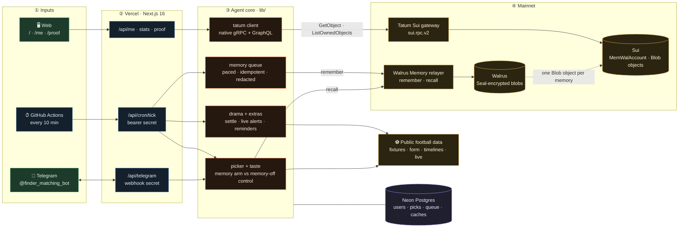
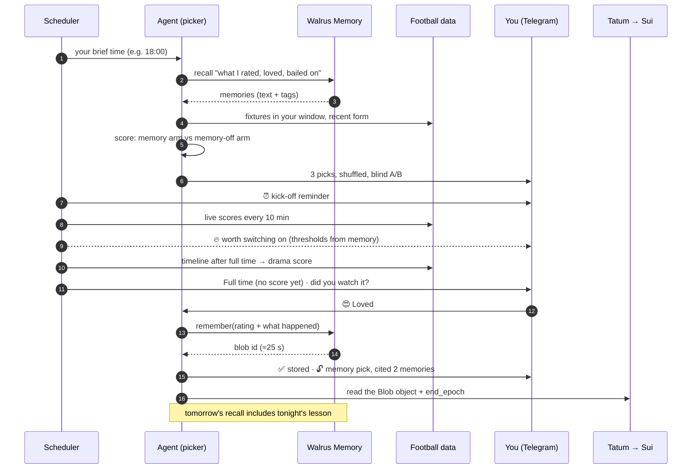
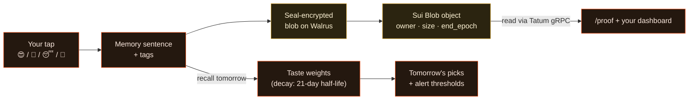

# Match Finder

**Total Recall (Tatum × Walrus) · Consumer Apps track · also for Best Walrus Memory**

Every evening Match Finder looks at the day's football fixtures (often 400+) and sends you the few worth your time, on Telegram. After full time you tap how it was. It reads what actually happened in the match, writes what it learned to **your Walrus Memory on Sui mainnet**, and uses those memories in tomorrow's picks. Every pick cites the memories (blob ids) that shaped it.

- **Bot:** https://t.me/finder_matching_bot
- **App:** https://matchfinder-memory.vercel.app
- **Proof (live, read from Sui through Tatum):** https://matchfinder-memory.vercel.app/proof · [docs/PROOF.md](docs/PROOF.md)

## What it saves you

| Without it | With Match Finder |
|---|---|
| Scrolling 400+ fixtures to find one worth staying up for | Three picks at the time you choose, inside the hours you can actually watch |
| Watching 90 minutes of a dead game | A "worth switching on" ping when a match in your window turns tight and late, at most twice a day |
| Missing kick-off | A reminder about 20 minutes before each pick |
| Spoilers in every app | Full-time messages hide the score until you've answered |
| Not knowing which highlights matter | One spoiler-free line: last night's match most worth the highlights |

Every one of those is tuned by memory: the leagues you enjoy, the styles you love or bail on (late goals, comebacks, cagey 0–0s), and the kick-off times you really stay up for.

## Architecture

Read left to right: who triggers work, the Vercel routes, the agent core, and the mainnet services it writes to and reads from. A daily Vercel cron backs up the GitHub Actions heartbeat.



## One day of learning



## What a memory looks like

Each memory is one readable sentence with a machine-readable tail. Recall returns the sentence; the agent turns the tags back into weights. There is no other copy of your taste.

```text
[rating] 2026-11-04 · Loved Como 4–1 Manchester United (UEFA Champions League · League Stage);
kicked off 23:45 my time. Drama 74/100: 5 goals, 2 after 75'.
tags: verdict=1.00 comp=2000001032 team=como team=manchester-united signal=high-scoring signal=late-goals kick=evening
```



## Where Walrus and Tatum do the work

| Concern | How |
|---|---|
| Memory store | `@mysten-incubation/memwal` 0.1.12 against the mainnet relayer: `remember` (queued, paced under the ~12/min/key limit, idempotency keys), `getRememberBulkStatus`, `recall` (sort recent + relevance), `listNamespaces` |
| Privacy | Seal-encrypted on Walrus; namespaces are HMAC-derived so no user id appears on-chain; credential-shaped strings are redacted before any write ([lib/memory.ts](lib/memory.ts)) |
| Chain reads | **Tatum Sui gateway, native gRPC** (`sui.rpc.v2` protos vendored from MystenLabs/sui-apis): `LedgerService/GetServiceInfo`, `LedgerService/GetObject` (the MemWalAccount: owner, delegate keys, active), `StateService/ListOwnedObjects` (every Walrus `Blob` object the account owns, with `storage.end_epoch`). GraphQL for delegate-key events ([lib/tatum.ts](lib/tatum.ts)) |
| Proof | Each stored memory's base64url blob id is converted to the on-chain u256 and matched to its Sui `Blob` object. The dashboard shows the Sui object and expiry epoch next to each memory; `npm run verify` writes [docs/PROOF.md](docs/PROOF.md) |
| Blind A/B | Two picks use memory, one is the same agent with memory off. The brief shows only neutral reasons; after you rate, the bot reveals which it was and which memories it cited |

## Bot commands

| Command | What it does |
|---|---|
| `/start` | Four taps: time zone, brief time, watch window, competitions you follow |
| `/picks` | Tonight's picks |
| `/me` | Your dashboard: picks with cited memories, learned weights, memory wall, A/B |
| `/teach <text>` | Save a preference, e.g. *I love late comebacks* or *no matches after 2am on weekdays* (plain messages work too) |
| `/alerts on\|off` | "Worth switching on" pings during matches |
| `/spoilers on\|off` | Show scores in full-time messages |
| `/settings` | Change time zone, brief time, watch window |

## Run it

```bash
npm install
cp .env.example .env.local                          # Tatum, Walrus Memory, Telegram, app secrets
node --env-file=.env.local scripts/local-runner.ts  # dev: long-polls Telegram + ticks every minute
npm run dev                                         # web UI
npm test                                            # unit tests
npm run verify                                      # cross-check stored memories against Sui via Tatum
```

## Honest limits

- The hosted relayer runs Seal decryption and embeddings, so it sees plaintext during writes and recalls (Walrus Memory's default path). Don't write anything you wouldn't tell a server you trust.
- The app operates one Walrus Memory account (custodial) with a namespace per user. Per-user self-custody is the next step.
- Memories last as long as their Walrus storage (currently `end_epoch` 57, about 15 epochs from write). There is no renew in the TS SDK yet; expiry is shown, not hidden.
- Live alerts poll every 10 minutes, so they can arrive a few minutes after a match turns.
- Football data comes from a public, anonymous API; no odds, no betting, no club or federation branding.
