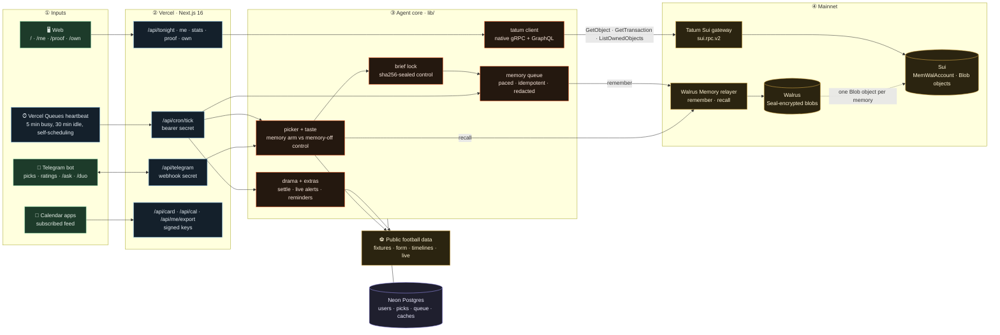
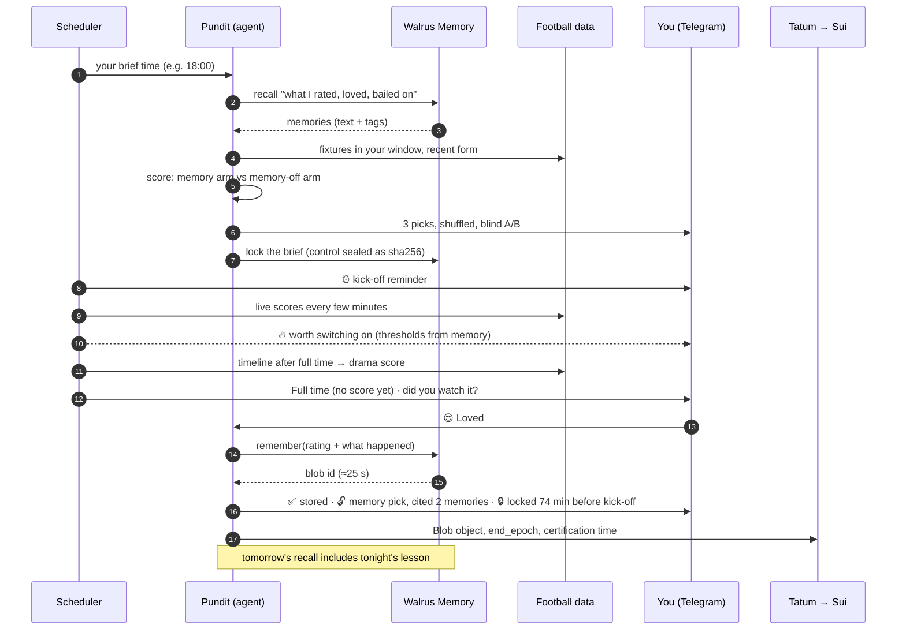
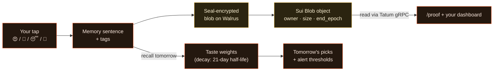

# Pocket Pundit

**The football pundit in your pocket.**

**Total Recall (Tatum × Walrus) · Track 3: Consumer Apps People Use (recommendation) · also for Best Walrus Memory**

Pocket Pundit is a personal football pundit on Telegram. Every evening it reads the day's fixtures, often 400 or more, and sends you the three worth your time. It only picks matches inside the hours you can actually watch, and it never spoils a score. After full time, one tap tells it how the match was. It checks what really happened in the match and keeps what it learned in **your own memory: encrypted on Walrus, verifiable on Sui mainnet**. Tomorrow's picks use that memory, and every pick cites the memories that shaped it.

- **Bot:** https://t.me/finder_matching_bot
- **Web:** https://pocket-pundit.vercel.app (includes a live "Tonight" board anyone can use)
- **Proof (live, read from Sui through Tatum):** https://pocket-pundit.vercel.app/proof · [docs/PROOF.md](docs/PROOF.md)

## Who it's for

Football fans who love the game but can't watch everything. Many live in Asia, where European football kicks off late at night, so a bad pick costs sleep. Pocket Pundit replaces scrolling, spoilers and missed thrillers with three good choices and one tap.

## What it saves you

| Without it | With Pocket Pundit |
|---|---|
| Scrolling 400+ fixtures to find one worth staying up for | Three picks at the time you choose, inside the hours you can actually watch |
| Watching 90 minutes of a dead game | A "worth switching on" ping when a match in your window turns tight and late (at most twice a day) |
| Missing kick-off | A reminder about 20 minutes before each pick, plus a calendar feed that fills itself |
| Spoilers in every app | Full-time messages hide the score until you've answered |
| Not knowing which highlights matter | One spoiler-free line opens each brief: last night's best match in your window, and whether it was one of your picks |
| Explaining your taste to every app | It learns from your taps. `/ask` shows what it knows, `/card` turns it into an image you can share, and `/export` hands you all of it |
| Agreeing with a friend on what to watch | `/duo` adds one shared pick a night for both of you |

Memory tunes every one of those: the leagues you enjoy, the styles you love or bail on (late goals, comebacks, cagey 0–0s), and the kick-off times you really stay up for.

It also learns from every match in your window, not just the three you rated. Each morning a **night report** ranks every match that finished in your window by what actually happened. It records where your picks landed, misses included, and how each competition did against the rest of the night. Both go to Walrus. The memory-on picks read that **league form** back the next evening; the memory-off pick never does.

## Why you can trust a pick

- **Blind A/B, every night.** Two picks use your memory. One is the same agent with memory switched off. The brief shows only neutral reasons. After you rate a match, the bot tells you which kind of pick it was and which memories it cited.
- **Locked before kick-off.** Each brief is written to Walrus before the first match starts. Which pick was the memory-off control is sealed as a sha256 commit. After the last full time, the bot reveals the salt, so you can recompute `sha256("<date>|control=<match>|<salt>")` yourself. The `/proof` page reads each lock's **certification time on Sui through Tatum** (`GetObject` → `previous_transaction` → `GetTransaction`) and shows how many minutes before kick-off it landed.
- **Your memory is yours.** There is no other copy of your taste. If recall returns nothing, the agent genuinely knows nothing.

## Architecture

Read left to right: who triggers work, the Vercel routes, the agent core, and the mainnet services it writes to and reads from. The heartbeat is a Vercel Queues message that schedules the next one (`/api/queues/heartbeat`): five minutes out while work is in motion, on the half hour when idle so the database can sleep, with a daily Vercel cron and an hourly GitHub Actions run as backups.



## One day with your pundit



## What a memory looks like

Each memory is one readable sentence with a machine-readable tail. Recall returns the sentence, and the agent turns the tags back into weights.

```text
[rating] 2026-11-04 · Loved Como 4–1 Manchester United (UEFA Champions League · League Stage);
kicked off 23:45 my time. Drama 74/100: 5 goals, 2 after 75'.
tags: verdict=1.00 comp=2000001032 team=como team=manchester-united signal=high-scoring signal=late-goals kick=evening

[brief] 2026-11-04 · Tonight's picks, locked before kick-off: Barcelona v Aston Villa (03:00); …
Memory-off pick sealed: commit 3f9a1c2b7d4e5f60. tags: kind=brief
```



## Where Walrus and Tatum do the work

| Concern | How |
|---|---|
| Memory store | `@mysten-incubation/memwal` 0.1.12 against the mainnet relayer: `remember` (queued, paced under the ~12/min/key limit, idempotency keys), `getRememberBulkStatus`, `recall` (recent and relevance sorts), `listNamespaces` |
| Ask your memory | `/ask <question>` runs a semantic `recall` over your own namespace and answers with the matching memories, each linked to its blob, plus the taste weights they add up to |
| Privacy | Seal-encrypted on Walrus. Namespaces are HMAC-derived, so no user id appears on-chain. Credential-shaped strings are redacted before any write ([lib/memory.ts](lib/memory.ts)) |
| Chain reads | **Tatum Sui gateway, native gRPC** (`sui.rpc.v2` protos vendored from MystenLabs/sui-apis): `LedgerService/GetServiceInfo`; `LedgerService/GetObject` (the MemWalAccount: owner, delegate keys, active); `StateService/ListOwnedObjects` (every Walrus `Blob` object the account owns, with `storage.end_epoch`); `LedgerService/GetTransaction` (checkpoint time of a lock's certification). GraphQL for delegate-key events ([lib/tatum.ts](lib/tatum.ts)) |
| Proof | Each stored memory's base64url blob id is converted to the on-chain u256 and matched to its Sui `Blob` object. The dashboard shows the Sui object and expiry epoch next to each memory; `npm run verify` writes [docs/PROOF.md](docs/PROOF.md) |
| Ownership (optional) | `/own` opens a page that uses the Wallet Standard (no JSON-RPC): the viewer's wallet calls `account::create_account` and `account::add_delegate_key` itself. The server finds the account with Tatum GraphQL (`AccountCreated` event) and verifies the key with Tatum gRPC `GetObject` before switching that viewer's writes and recalls to their account. Removing the key is detected at the next brief ([lib/own.ts](lib/own.ts)) |
| Portability | Memories follow a documented sentence + tags format ([docs/MEMORY-FORMAT.md](docs/MEMORY-FORMAT.md)); `/export` downloads a taste passport any app can rebuild the same taste from |
| Blind A/B + locks | Two memory picks and one memory-off control, shuffled, with neutral reasons only. The brief is locked on Walrus before kick-off, with the control sealed by a commit that is revealed after the last full time ([lib/lock.ts](lib/lock.ts)) |
| Night reports + league form | Once a window closes, every finished match in it is ranked by drama from the public timeline. A `[night]` memory records where the picks landed (no arms, so the seal holds). A `[form]` memory scores each competition against the night's average, shrunk for small samples. Memory-on picks read league form back, worth at most 16 of 100 points. The record ("night's best caught") is on the landing page and in `/api/stats` ([lib/night.ts](lib/night.ts)) |

## Bot commands

| Command | What it does |
|---|---|
| `/start` | Four taps: time zone, brief time, watch window, competitions you follow |
| `/picks` | Tonight's three |
| `/ask <question>` | Ask your memory, e.g. *which leagues do I enjoy?* |
| `/card` | Your football taste as a shareable image |
| `/calendar` | A private feed for Google or Apple Calendar, with a 20-minute reminder on each pick |
| `/duo` | Pair with a friend: one extra pick a night that suits both tastes and both watch windows (neither sees the other's memories) |
| `/export` | Download your taste passport: every memory with its Walrus blob link, plus the learned weights |
| `/own` | Optional: move your memory into a Walrus Memory account your own Sui wallet controls, and remove the app's key whenever you like |
| `/teach <text>` | Save a preference, e.g. *I love late comebacks* or *no matches after 2am on weekdays* (plain messages work too) |
| `/me` | Your private dashboard: picks with cited memories, learned weights, memory wall, A/B |
| `/alerts on\|off` | "Worth switching on" pings during matches |
| `/spoilers on\|off` | Show scores in full-time messages |
| `/settings` | Change time zone, brief time, watch window |

## Run it

```bash
npm install
cp .env.example .env.local                          # Tatum, Walrus Memory, Telegram, app secrets
node --env-file=.env.local scripts/local-runner.ts  # dev: long-polls Telegram + ticks every minute
npm run dev                                         # web UI
npm test                                            # unit tests
npm run verify                                      # cross-check stored memories against Sui via Tatum
```

## Honest limits

- The hosted relayer runs Seal decryption and embeddings, so it sees plaintext during writes and recalls (Walrus Memory's default path). Don't write anything you wouldn't tell a server you trust.
- By default the app operates one Walrus Memory account with a namespace per user, so nobody needs a wallet. Viewers who want custody can move to their own account with `/own`. Memories saved before removing the app's key stay readable by that key (Walrus Memory's forward-only revocation).
- Memories last as long as their Walrus storage (currently about 15 epochs from write). The TS SDK has no renew yet, so expiry is shown rather than hidden.
- Live alerts depend on the scheduler's cadence, so they can arrive a few minutes after a match turns.
- Football data comes from a public, anonymous API. There are no odds and no betting. Club crests are generated monograms by default; the feed's official team pictures only appear if `OFFICIAL_CRESTS=1` is set, which stays off until their use is cleared.
- The public feed has results and timelines for some competitions only (it leaves several big leagues "scheduled"). Picks prefer competitions it settles, on both A/B arms, and matches without a result are still asked about.
