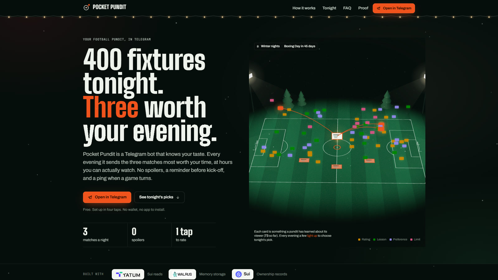
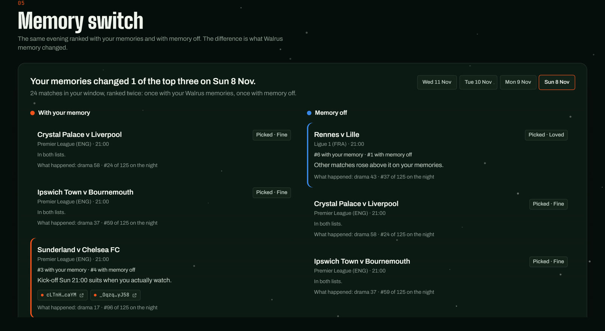
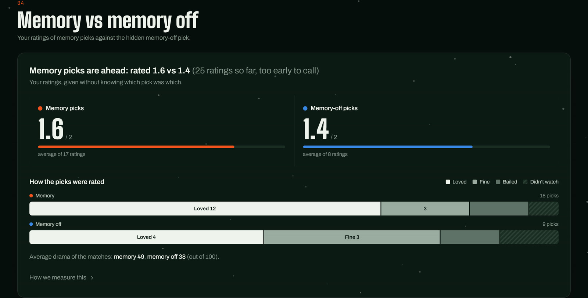
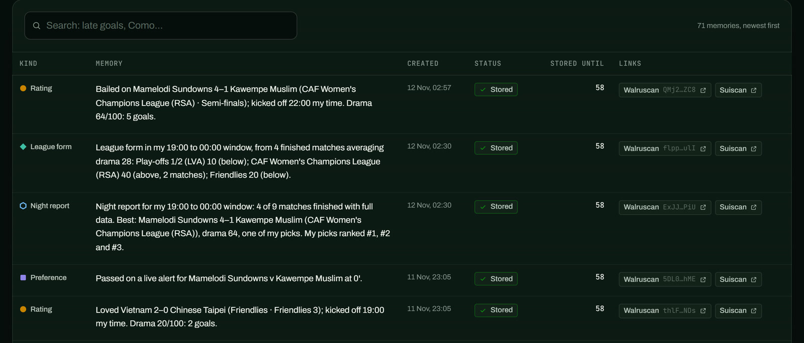
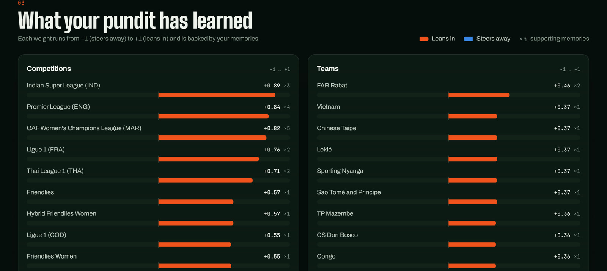
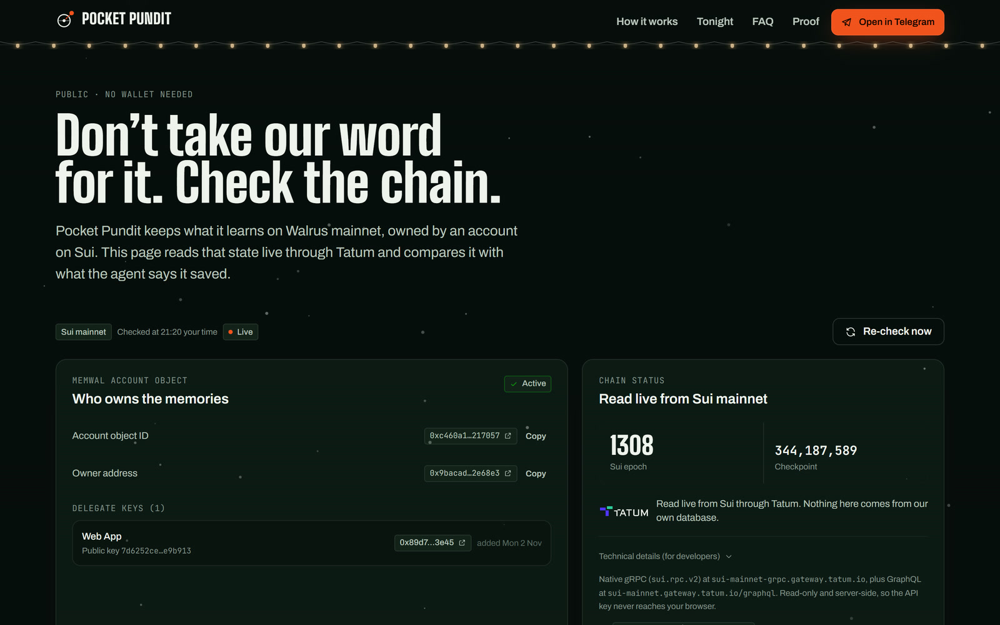
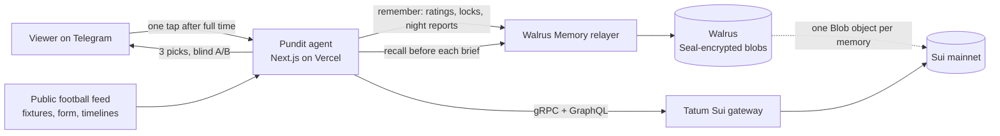

# Pocket Pundit

**The football pundit in your pocket.** A Telegram bot that picks the three football matches worth your evening, learns your taste in your own Walrus Memory, and proves every night that the memory helps.

**Total Recall (Tatum × Walrus) · Track 1: Markets & Sports Prediction · also entering Best Walrus Memory**

[Open the bot](https://t.me/finder_matching_bot) · [Web app](https://pocket-pundit.vercel.app) · [Live proof from Sui](https://pocket-pundit.vercel.app/proof) · [Live numbers](https://pocket-pundit.vercel.app/api/stats) · [Judges' guide](docs/TOTAL_RECALL.md)
<!-- DEMO_VIDEO -->



## In 30 seconds

- Every evening it reads the day's fixtures (often 200 to 500) and sends **three picks on Telegram**, only inside the hours you can actually watch, with no spoilers.
- After full time you tap **Loved, Fine, Bailed or Didn't watch**. It checks what really happened from the match timeline and writes the lesson to **your Walrus Memory on Sui mainnet**.
- The next evening it **recalls those memories** before picking, and every pick cites the Walrus blobs behind it.
- Every night is a **blind A/B test**, locked on Walrus before kick-off, with the lock's certification time **read from Sui through Tatum**.

Running on mainnet every evening since 3 Nov 2026. As of 11 Nov: **73 memories** on Walrus, **73 of 73** matched to their Sui objects, **27 of 27** picks rated by the viewer.

## What to look at first

| | What you'll see | Where |
|---|---|---|
| 1 | **Memory switch:** the same evening ranked with memory on and with memory off, side by side, with what actually happened | `/me` dashboard, image below |
| 2 | **Blind A/B:** memory picks against a hidden memory-off pick, rated before the arm is revealed | [/api/stats](https://pocket-pundit.vercel.app/api/stats) |
| 3 | **Locked before kick-off:** each brief is written to Walrus first, and the bot replies with the Sui checkpoint that certified it | the bot, [/proof](https://pocket-pundit.vercel.app/proof) |
| 4 | **Every memory checkable:** /proof reads the memory account and every Walrus Blob object live through Tatum gRPC | [/proof](https://pocket-pundit.vercel.app/proof) |

## Proof that memory changes the picks

### 1. Memory switch: what memory changed tonight

At brief time every match in the viewer's window is scored twice, with their Walrus memories and with memory off, and both top threes are stored. Once the night's picks have finished, the dashboard shows them side by side: which matches memory brought in, which it dropped, why, the blobs behind each reason, and the next morning, how each one actually went.



**8 Nov, a real night, including a miss.** Memory brought in Sunderland v Chelsea and pushed Rennes v Lille from #1 to #6. Rennes v Lille was still sent, as the hidden memory-off pick, and the viewer loved it. Sunderland v Chelsea finished 96th of 125 on drama. Memory got that one wrong, and the record shows it, on Walrus, where it can't be edited.

### 2. Blind A/B, every night

Two picks use memory. One is the same agent with memory switched off. They are shuffled and shown with the same neutral reasons, and the score is hidden until the viewer rates them.

| As of 11 Nov ([live](https://pocket-pundit.vercel.app/api/stats)) | Memory picks | Memory-off picks |
|---|---|---|
| Picks rated | 18 | 9 |
| Loved / Fine / Bailed / Didn't watch | 12 / 3 / 2 / 1 | 4 / 3 / 1 / 1 |
| Average rating (Loved 2, Fine 1, Bailed 0) | **1.59** | **1.38** |



One viewer and 27 picks show the loop working, not a settled effect. The dashboard says "too early to call" for the same reason.

### 3. Night reports, misses included

When the viewer's window closes, every finished match in it is ranked by drama from the public timeline. A `[night]` memory records where the picks landed, and a `[form]` memory scores each competition against the night's average, which only the memory picks read back. So far the night's best match was among the picks on **5 of 8 nights** (3 times through a memory pick, twice through the memory-off pick).

### 4. Locked before kick-off, certified on Sui, read through Tatum

Each brief is written to Walrus before the first kick-off. Which pick is the memory-off control is sealed as `sha256("<date>|control=<match>|<salt>")`, and the salt is revealed after the last full time. The bot's real messages for 8 Nov:

```text
🔒 Tonight's picks are locked on Walrus · GgcS86…4Csk
Certified on Sui at 18:00 your time, checkpoint 342,975,997, 3 h before the first kick-off. Read back through Tatum.

FT · Rennes 1–2 Lille
Ligue 1 (FRA)
Drama 43/100 · 3 goals, 14 attempts

You: loved · ✅ stored on Walrus · OEom5x…094w
🔓 Memory-off pick: the control in your A/B test.
🔒 Certified on Sui 3 h before kick-off (checkpoint 342,975,997, via Tatum)
Seal check: seal ✓ 1aae382c89db1a5e = sha256("2026-11-08|control=a4ep75tn606lhsdz14n5ikt1w|34k69D3hN1w31ltP")
🧠 Memory switch: with memory off, tonight's top three would have been Rennes v Lille, Crystal Palace v Liverpool and Ipswich Town v Bournemouth. Your memories brought in Sunderland v Chelsea FC.
```

Anyone can recompute that hash. The certification time comes from Tatum gRPC: `GetObject` on the Blob gives its `previous_transaction`, and `GetTransaction` gives the checkpoint and timestamp.

## What a memory looks like

One readable sentence with a machine-readable tail. Recall returns the sentence, and the picker turns the tags back into weights (21-day half-life). This is the rating above, as stored on Walrus ([blob](https://walruscan.com/mainnet/blob/OEom5xRViyxCfBxlpRnpMoyNql0bKHjTDYBv7Nr094w)):

```text
[rating] 2026-11-09 · Loved Rennes 1–2 Lille (Ligue 1 (FRA) · Regular Season); kicked off 21:00 my time.
Drama 43/100: 3 goals. tags: verdict=1.00 comp=2000000018 team=rennes team=lille signal=tense kick=evening
```

The viewer sees every memory, with its Walrus and Sui links, and what the memories add up to:





Seven kinds of memory, 73 in total: `rating` (27), `night` (11), `lesson` (9), `brief` locks (8), `preference` (8), `form` (8) and `system` (2). Mistakes get a correction memory that supersedes the original, which stays on Walrus. Format: [docs/MEMORY-FORMAT.md](docs/MEMORY-FORMAT.md).

## Walrus and Tatum integration

| | How | Code |
|---|---|---|
| **Walrus Memory** writes | `@mysten-incubation/memwal` on the mainnet relayer. A durable queue paces `remember` under the relayer limit, with idempotency keys and backoff up to 12 attempts, so a rating is never lost or written twice. `getRememberBulkStatus` settles each write to a blob id. | [lib/memory.ts](lib/memory.ts) |
| **Walrus Memory** reads | Three `recall` queries before every brief (recent ratings, taste, league form). `/ask` runs a semantic recall over the viewer's own namespace. | [lib/memory.ts](lib/memory.ts), [lib/picker.ts](lib/picker.ts) |
| Privacy | Seal-encrypted blobs. Namespaces are HMAC-derived, so no Telegram id appears on-chain. Credential-shaped text is redacted before any write. | [lib/memory.ts](lib/memory.ts) |
| **Tatum** gRPC `LedgerService/GetServiceInfo` | Chain status on /proof | [lib/tatum.ts](lib/tatum.ts) |
| **Tatum** gRPC `LedgerService/GetObject` | The MemWalAccount (owner, delegate keys, active), and each Blob's last transaction | [lib/tatum.ts](lib/tatum.ts) |
| **Tatum** gRPC `StateService/ListOwnedObjects` | Every Walrus Blob object the account owns, matched one to one with stored memories (blob id to on-chain u256) | [lib/tatum.ts](lib/tatum.ts) |
| **Tatum** gRPC `LedgerService/GetTransaction` | When Sui certified each brief lock, for /proof and the bot's lock reply | [lib/lock.ts](lib/lock.ts) |
| **Tatum** GraphQL `events` | Delegate-key history, and finding a viewer's own account (`AccountCreated`) for `/own` | [lib/own.ts](lib/own.ts) |
| Ownership | `/own` moves a viewer's memory into a Walrus Memory account their own wallet controls (Wallet Standard, no JSON-RPC). `/export` hands over a documented taste passport. | [lib/own.ts](lib/own.ts) |



## Try it in a minute

1. Open [t.me/finder_matching_bot](https://t.me/finder_matching_bot) and tap through setup: time zone, brief time, the hours you watch, the leagues you follow. No wallet, nothing to install.
2. Tonight's three picks arrive at your brief time, followed by the lock reply with its Sui checkpoint.
3. Try `/ask which leagues do I enjoy?`, `/card`, `/duo` or `/export`. Tap "Why these picks?" for your dashboard.
4. Open [/proof](https://pocket-pundit.vercel.app/proof) to see every memory matched to its Sui object, read live through Tatum.

<details>
<summary>All bot commands</summary>

| Command | What it does |
|---|---|
| `/start` | Four taps: time zone, brief time, watch window, competitions |
| `/picks` | Tonight's three |
| `/ask <question>` | Ask your memory, e.g. *which leagues do I enjoy?* |
| `/teach <text>` | Save a preference, e.g. *I love late comebacks* |
| `/card` | Your taste as a shareable image |
| `/calendar` | A private calendar feed with a reminder on each pick |
| `/duo` | One extra shared pick a night with a friend, for both tastes and both time zones |
| `/export` | Your taste passport: every memory with its Walrus link |
| `/own` | Move your memory into a Walrus Memory account your wallet controls |
| `/me` | Your private dashboard |
| `/alerts`, `/spoilers`, `/settings` | Live "worth switching on" pings, scores in full-time messages, your hours |

</details>

## How it fits together



A Vercel Queues heartbeat drives the agent: every five minutes while matches, reminders or memory writes are in motion, on the half hour otherwise. Neon Postgres holds users, picks and the write queue.

## Engineering

- **84 tests** (`npm test`): unit tests plus end-to-end runs of the whole bot against a fake football world, a fake Telegram and the Walrus Memory SDK's `MemWalMock`.
- **Deterministic picker, no LLM in the picking path.** Every reason traces to a weight, and every weight to a blob.
- **Durable, idempotent memory writes**, paced for the relayer's rate limit, with retries and backoff.
- **Read-only, server-side chain access**: the Tatum key never reaches the browser.
- `npm run verify` cross-checks every stored memory against its Sui object and writes a snapshot to [docs/PROOF.md](docs/PROOF.md).

```bash
npm install
cp .env.example .env.local                          # Tatum, Walrus Memory, Telegram and app secrets
node --env-file=.env.local scripts/local-runner.ts  # long-polls Telegram and ticks every minute
npm run dev                                         # web app
npm test
```

## Honest limits

- One real viewer so far, so the A/B shows the loop working, not a settled effect size.
- Until 8 Nov the brief showed each pick's score, and the memory-off pick's was usually the lowest, so the first ratings weren't fully blind. Scores and memory reasons now stay hidden until a pick is rated.
- The public football feed settles some competitions only. Picks prefer competitions it settles, on both A/B arms alike.
- The hosted relayer sees plaintext while it embeds and encrypts (Walrus Memory's default path). Nothing credential-shaped is written.
- Two night reports needed corrections (6 and 9 Nov). Each correction is a new memory that supersedes the old one, and both stay on Walrus.
- No odds, no betting, no club branding.

## More

- [docs/TOTAL_RECALL.md](docs/TOTAL_RECALL.md): judging criteria mapped to evidence, with mainnet links
- [docs/MEMORY-FORMAT.md](docs/MEMORY-FORMAT.md): the memory format and taste rules
- [docs/PROOF.md](docs/PROOF.md): an on-chain snapshot from 5 Nov (the [/proof](https://pocket-pundit.vercel.app/proof) page is the live version)
- [docs/BLOG.md](docs/BLOG.md): the story behind it
